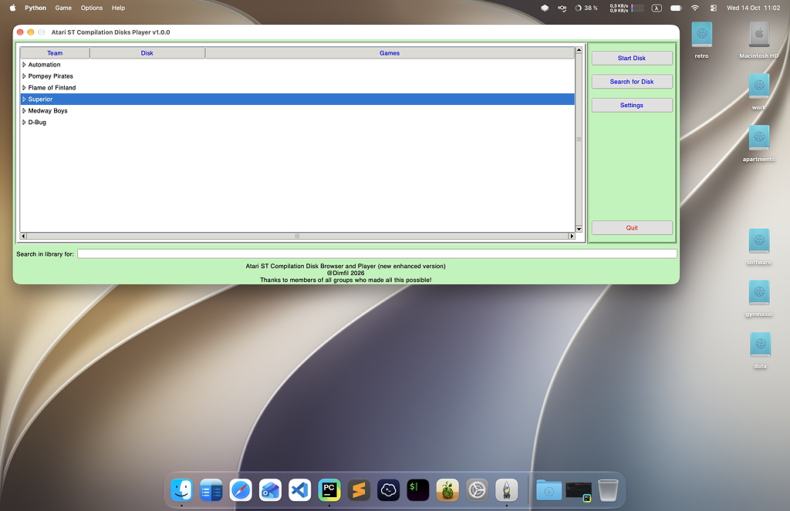
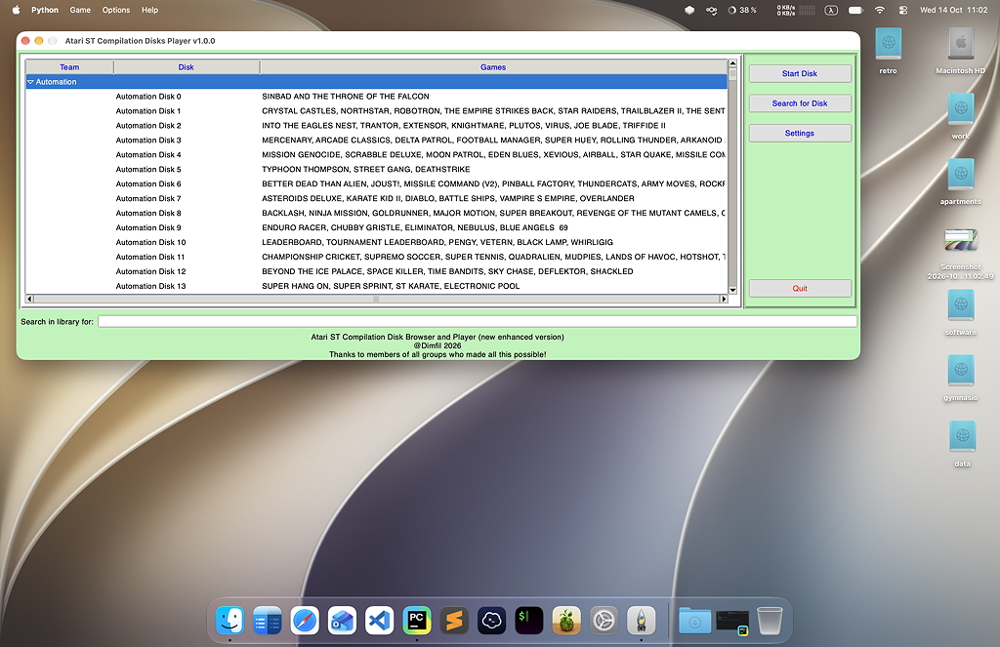
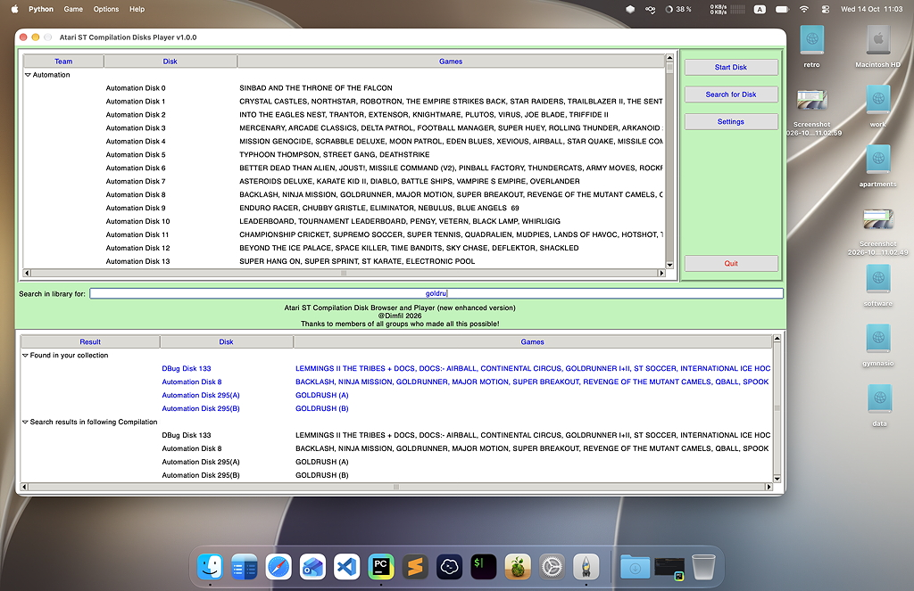
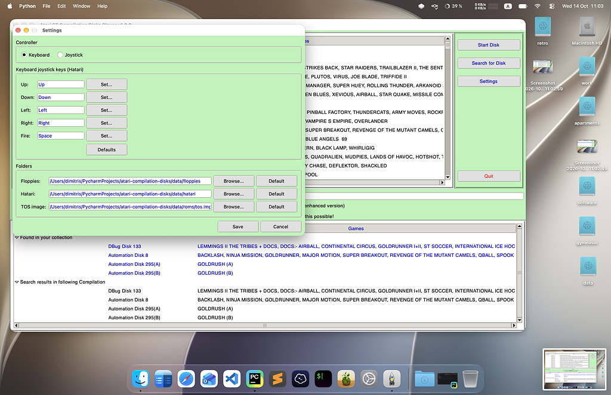
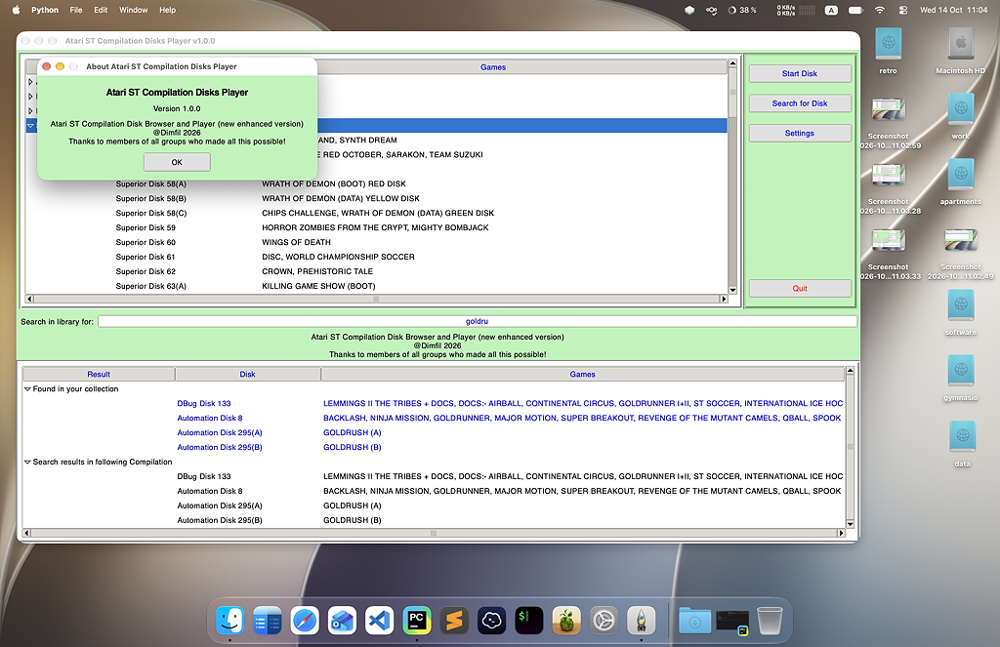

# Atari ST Compilation Disks Player

Atari ST Compilation Disks Player is a desktop browser and player for the classic **Atari ST compilation disks** released by the great cracking and compilation teams of the scene: 285 teams and over 4,500 disks. It lists your collection of floppy images grouped by team, searches both your collection and the full catalogue of supported releases (`CompDisks.json`), and launches any disk in the [Hatari](https://hatari.tuxfamily.org/) emulator with one click.

The app does not ship the disk images. You supply your own collection, and the app finds it in the `data/floppies` folder.

## What the app does

- **Browse by team**: the library is grouped by team: Automation, Pompey Pirates, Flame of Finland, Medway Boys, Superior, D-Bug and 279 other teams (Evil Force, The Replicants and many more). Only teams for which you have a folder and disks are listed. Each disk shows its number and the games it contains.
- **Screenshot**: selecting a disk shows its menu screenshot above the buttons. The images are looked up by the `Screenshot` key of the disk in `CompDisks.json`, in `data/menu_screenshots` (not shipped; copy the screenshots there). Without a matching file the preview stays empty.
- **Search**: type in the *Search in library for* field to search your collection and, below it, the full catalogue of all supported teams. Disks you own are shown in blue.
- **Start Disk**: extracts the disk image if needed and starts Hatari as an Atari ST 1040 (1 MB of RAM) with the TOS image in `data/roms/tos.img`. It runs fullscreen on a TV monitor, with the disk loaded in drive A.
- **Settings**: choose the controller (keyboard or joystick), the joystick keys, and the floppies, Hatari and TOS locations.

## Screenshots

**Main window at start-up**



**A team expanded, listing its disks and games**



**Searching the library**



**Settings**



**About**



## Using the app

- **Browse**: expand a team in the tree to see its disks. Disks you own are shown in blue in the search results.
- **Search**: type in the *Search in library for* field. Results appear in two groups: *Found in your collection* and *Search results in following Compilation* (the full catalogue). Clear the field to hide the results again.
- **Launching a disk**: select it and click **Start Disk** (or press Ctrl+S), or double-click it. Hatari must be installed (see *Requirements*) and the floppy image must be in your collection.
- **Other buttons**: **Search for Disk** (Ctrl+F) jumps to the search field, **Settings** opens the settings window, and **Quit** closes the app.
- **Multiple disks**: some games use two or more disks, noted as (A), (B) and so on. Most of them do not support a second drive, so swap the floppy image yourself from the emulator's GUI (F12).

### Emulator keys

- **F12**: enter the emulator's GUI
- **Q**: quit the emulator
- **Esc**: toggle fullscreen/windowed mode
- **Cmd+C** (Mac) or **AltGr+C** (Windows): cold reset
- **Cmd+R** (Mac) or **AltGr+R** (Windows): warm reset

The joystick is emulated with the cursor keys for movement and Space for Fire. You can change them in Settings.

## Requirements

- Python 3.11 or later with Tk (the standard `tkinter`)
- [Hatari](https://hatari.tuxfamily.org/) to run the disks.
  - **macOS**: install it in `/Applications`, or with `brew install hatari`, and make sure the `hatari` command is in your `PATH`.
  - **Windows**: place the Hatari executable in `data/hatari`.
- A TOS image saved as `data/roms/tos.img` (or selected in Settings). The repository does not include one, because TOS is copyrighted: supply your own dump of an Atari ST ROM. **TOS 1.04 is recommended** for the best compatibility. The `data/hatari/atari_keys` Hatari config is included.

Run the app with the start script for your system. It creates a `.venv` virtual environment, installs `requirements.txt` when it has changed, and starts the app:

- **macOS**: double-click `start_macos.command`
- **Windows**: double-click `start_windows.bat` (it offers to install Python with winget if it is missing)
- **Linux**: run `./start_linux.sh` (or double-click it and choose "Run")

Or start it yourself:

```sh
python3 comp_disks_player.py     # macOS, Linux (Terminal)
python comp_disks_player.py      # Windows (Command Prompt)
```

## Populating the folders

The app finds your disks under `data/floppies`, in one sub-folder per team:

```
data/
├── floppies/
│   ├── Automation/
│   ├── D_Bug/
│   ├── Flame_of_Finland/
│   ├── Medway_Boys/
│   ├── Pompey_Pirates/
│   ├── Superior/
│   └── ...             one folder per other team
├── hatari/             atari_keys (and the Hatari executable on Windows)
└── roms/               tos.img
```

Each team has its own sub-folder, named exactly as the `Folder` key of its entries in `CompDisks.json` (for example `Pompey_Pirates` or `Evil_Force`). The folder name is the team name with spaces and punctuation replaced by underscores. Folder names are case-sensitive, and a disk is only listed when its team folder exists. Create only the folders you need.

The player recognises the filenames listed in the `File` key of each `CompDisks.json` entry, including `.ST` and `.MSA` images. Matching is not case-sensitive. `data/CompDisksNaming.csv` lists, for every disk of every team, the team, the folder name, the disk name and the file name to use, including the full `Folder/File` path. For a few disks the `File` value is a `.zip` name, because the image inside the ZIP has a different name. Most collections available online already have correct names. If an image is stored as a same-named `.zip`, it is found too. A ZIP should contain one `.ST` or `.MSA` image (a matching image name is preferred if there are several).

If you have no disks yet, a good place to start is <https://archive.org/details/atari-st-collection-1997-cdr-alien-pompey-pirates>. Other good places to download menu disks are:

- [Atari Legend](https://www.atarilegend.com)
- <https://www.exxosforum.co.uk/atari/games/index.htm>
- <http://www.homecomputerworld.com/automationsite1.html>

When the app starts, it fills the tree according to the floppy images it finds, grouped by team.

## Settings

Open **Settings** from the main window (or **Options > Settings...**). Everything is saved in a per-user `settings.ini` file, so you can edit it by hand if needed.

| Setting | What it does |
| --- | --- |
| **Controller** | *Keyboard* maps a joystick onto keys. *Joystick* uses a real gamepad or joystick in Hatari. |
| **Keyboard joystick keys** | Choose the keys for Up, Down, Left, Right and Fire. Click **Set...** and press a key. Defaults: arrow keys and Space. **Defaults** resets them. Your `atari_keys` file is never modified, because a modified copy is used at launch. |
| **Floppies** | The folder that holds your disk images (default `data/floppies`). |
| **Hatari** | The folder that holds Hatari and `atari_keys` (default `data/hatari`). |
| **TOS image** | The TOS ROM file (default `data/roms/tos.img`). |

## Building a standalone app

```sh
pip install -r requirements.txt
python build.py
```

This builds an executable with PyInstaller into `dist/`, for macOS or Windows depending on where you run it. After a successful build, move the executable to the main project directory.

## Credits

- Thanks to the members of all the teams who made these compilations possible.
- The original disk catalogue comes from [www.stonish.net](https://www.stonish.net), which is now part of [Atari Legend](https://www.atarilegend.com).
- The database behind the extra teams' disk and game lists, and the screenshots, come from [Atari Legend](https://www.atarilegend.com).
- The Atari TOS ROM and the disk images are not part of this project and remain the property of their respective owners.

I hope you find it useful. If needed, please open an issue on GitHub.

## License

The code is released under the [MIT License](LICENSE). The Atari TOS ROM and the disk images are not covered by it.

Have fun...!!!
